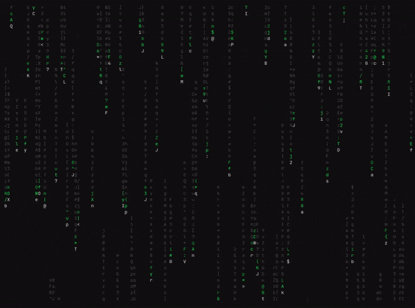

# asmatrix

Matrix rain in pure assembly for Linux (x86-64 and ARM64) and Windows.

> I did this in order to see the potential of Assembly, and how even low-level languages can compare in raw performance for the same result.

 Benchmarks:
| Metric | asmatrix | cmatrix |
|---|---|---|
| CPU cycles | 11,251,832 | 193,819,938 |
| Instructions | 10,825,898 | 220,158,233 |
| Cache misses | 3,897 | 156,683 |
| RSS (physical RAM) | 40 kB | 4,728 kB |
| Virtual memory | 256 kB | 6,336 kB |



## Install
```bash
sudo curl -fsSL https://github.com/ungaul/asmatrix/releases/download/latest/asmatrix-linux-x86_64 -o /usr/local/bin/asmatrix && sudo chmod +x /usr/local/bin/asmatrix
```

## Build from source
| Target | Command | Needs | Output |
|---|---|---|---|
| Linux x86-64 | `make` | `nasm`, `ld` | `asmatrix` |
| Linux ARM64 | `make` on ARM, or `make arm64` to cross-build | `as`, `ld` (`aarch64-linux-gnu-binutils` when cross-building) | `asmatrix` / `asmatrix-arm64` |
| Windows x64 | `make windows` | `nasm` | `asmatrix.exe` |

```bash
make
sudo cp ./asmatrix /usr/local/bin/
```

The x86-64 Linux and Windows builds share `matrix.asm`. The ARM64 version is `matrix_arm64.s`.

The Windows build writes the `.exe` directly, with no linker or SDK. It needs Windows 10 or later and a terminal with ANSI support, such as Windows Terminal. Windows on ARM runs it through its built-in x64 emulation.

## Usage
```bash
asmatrix [--density 1-9] [--speed 1-9] [--color SPEC]

  --density 1-9   Column density   (1=sparse ... 9=dense,  default 5)
  --speed 1-9     Animation speed  (1=slow   ... 9=fast,   default 7)
  --color SPEC    Color: name, hex (#RRGGBB), or ANSI 0-255  (default: green)
  --help          Show this message
```

While running, the Up and Down arrows change the speed and Ctrl+C quits.
